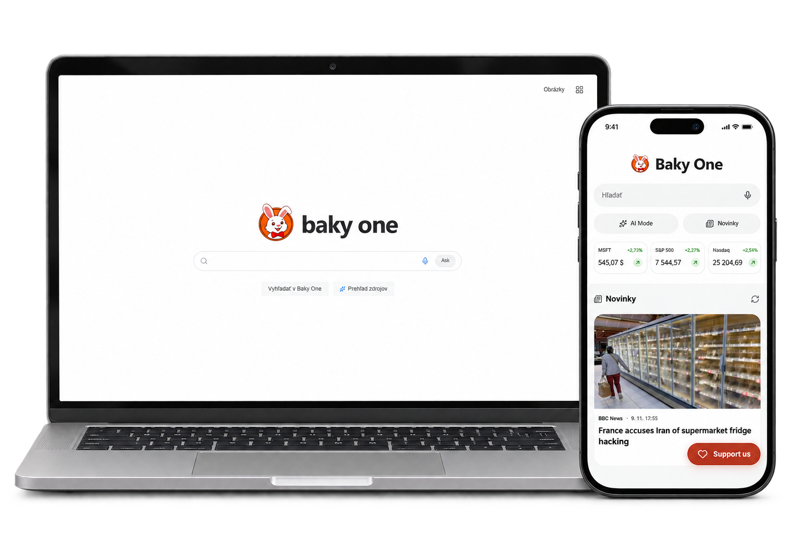

# Baky One

Baky One is a modern, open-source search engine built by Baky OS as part of its ecosystem. It brings web pages, images, videos, YouTube Shorts, and news into a Slovak-language interface for desktop and mobile. The project is designed around privacy and can be run on your own server.

[Try Baky One](https://baky-one.vercel.app/) · [Explore Baky OS](https://www.bakyos.com/)



## What you can do

- **Search across formats.** Switch between web results, images, videos, Shorts, and news without retyping your query.
- **Refine your results.** Choose Slovakia, Czechia, Europe, or worldwide as your search region. Use date filters and SafeSearch where supported by the source.
- **Find the right website.** Baky One ranks links using the query, page title, and destination domain. It also reduces duplicate links and repeated results from the same domain.
- **Read a quick overview.** Enable the source overview to see a Wikipedia summary with a link to the original article when a matching article is available.
- **Catch up on mobile.** The mobile homepage includes publisher news and informational quotes for Microsoft, the S&P 500, and the Nasdaq Composite. Quotes may be delayed or reflect the last trading session.
- **Explore the Baky OS ecosystem.** The app menu includes Baky OS, Baky AI, Baky Finance, and Baky News. The mobile AI Mode shortcut opens Baky AI.

## How search works

Baky One combines web results from DuckDuckGo, Bing, and Seznam. The server requests results from multiple sources in parallel, then ranks and deduplicates the links. It can fetch more source pages when the first page is sparse or several results come from the same domain. The first page shows up to ten relevant links.

When a provider explicitly suggests a spelling correction, Baky One checks it before using those results. The check protects model numbers, search operators, and quoted phrases. The interface shows the corrected query when it uses corrected results. Availability, coverage, and response times depend on the upstream sources. When a source fails, Baky One can show results from the sources that answered.

## Privacy

Baky One keeps the active search session in browser memory. The app clears it when the tab is hidden or the page is left. The Escape button on the results page also clears the active search and attempts to open AccuWeather. Search queries stay out of browser storage, application caches, and application logs. Search responses use `Cache-Control: no-store`.

The server sends queries to external search providers and, where applicable, overview sources. Hosting and third-party services can process requests and keep their own records. Images and embedded players loaded directly from third-party websites can see your browser’s IP address. Voice input, when available, uses your browser’s speech recognition service.

## Run Baky One locally

You’ll need **Node.js 24** and **npm 11**.

```sh
git clone https://github.com/GeneralMartin180/Baky-one-.git baky-one
cd baky-one
npm ci
npm run dev
```

Open [http://localhost:3000](http://localhost:3000). Basic search works without an API key. For optional settings, copy [`.env.example`](.env.example) to `.env.local`.

- `PORT` changes the local server port.
- `BRAVE_SEARCH_API_KEY` adds Brave Search as a web result source. Keep it on the server.
- `PROXY_URL`, `HTTP_PROXY`, and `HTTPS_PROXY` configure an HTTP proxy for server requests.
- `TOR_PROXY_URL` takes precedence over the HTTP proxy. Set `SEARCH_NETWORK_MODE=tor_socks` to require a SOCKS connection. Requests fail if that connection is unavailable.

## Code and tests

The frontend uses React, TypeScript, and Vite. The Node.js API uses Express and shares the same handlers between local runs and the Vercel deployment.

- [`src/components/`](src/components/) contains the homepage, search interface, and result views.
- [`src/serverApp.ts`](src/serverApp.ts) defines the API routes and request handling.
- [`src/services/webSearchService.ts`](src/services/webSearchService.ts) gathers and ranks web results using [`searchRanking.ts`](src/services/searchRanking.ts).
- [`tests/`](tests/) covers the API, search ranking, provider failures, privacy behavior, and frontend interactions.

Run the type checker and test suite:

```sh
npm run lint
npm test
```

Build and run the production version locally:

```sh
npm run build
npm start
```

For a live check against the running local app, use `npm run test:live`. Add a site URL to check another deployment and `--media` to include media endpoints.

```sh
npm run test:live -- https://baky-one.vercel.app --media
```

## Deployment

The hosted version uses Vercel. It runs `npm ci` and `npm run build:vercel` to publish the static frontend and a bundled Node.js function. The project’s deployment settings are in [`vercel.json`](vercel.json).

## Contributing

Open an issue for a bug or feature idea, or send a pull request. For search issues, include the query, region, filters, and the result you expected. Please use an example you’re comfortable sharing publicly.

## License

Baky One is released under the [MIT License](LICENSE).
